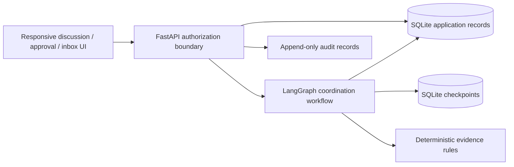
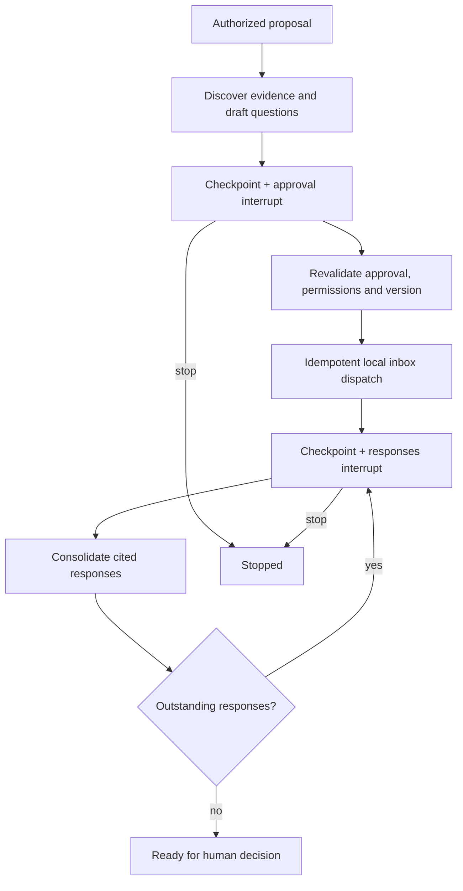

# Architecture and decision register

Status: narrow local MVP; architecture recorded before implementation, 2026-11-13.

## Scope and trust boundary

A coordinator proposes a change. Evidence-based rules suggest departments and questions. A human edits/rejects suggestions and explicitly authorizes dispatch to local department inboxes. Department identities answer only their questions; the workflow consolidates evidence and outstanding work. All users, departments, inbox deliveries, and scenarios are synthetic. No external messages or LLM calls occur.

This implements a reproducible coordination baseline. It does **not** establish that a language model understands unseen business contexts. Free-form extraction and novel stakeholder discovery remain hypotheses to evaluate separately.

## Decisions

| ADR | Decision | Reason / consequence |
|---|---|---|
| 001 | Python, FastAPI, SQLite, static HTML/CSS/JS | One local process and no build service; a small API is independently testable. SQLite is suitable for the single-process demo, not a claim of enterprise capacity. |
| 002 | Real LangGraph with persistent SQLite checkpoints | Approval and asynchronous consultation are durable state transitions; retain checkpoints across process restarts. Conventional CRUD and permissions stay outside graph nodes. |
| 003 | One coordination graph, deterministic specialist functions | Separate model agents add cost and nondeterminism without evidence of benefit. Runtime functions are not falsely represented as autonomous LLM agents. |
| 004 | Explicit approval before local delivery | No autonomous dispatch in MVP. An edited question replaces its approved payload; rejection produces no delivery. Approval is per-recipient, tied to the question/version. |
| 005 | Human review of inferred records | Response text is evidence, not authority. Proposed/approved decisions have separate statuses. Do not turn “looks good” into formal approval. |
| 006 | Local synthetic identity boundary | Authenticate requests using server-validated local sessions/tokens; never trust a client-provided role or department. Demo credentials and identity switching are unsuitable for production. |
| 007 | Structured consultation records and bounded rounds | Question identifiers and unique dispatch keys prevent duplicates. At most one initial consultation per department; additional rounds must be independently justified and approved. |
| 008 | No production queue or federation in slice | Local inbox records are notifications. Explicit polling and synchronous graph invocation suffice; production would need an outbox worker, retry policy, queue and federated identity. |

## Components

Recommended graph topology:

## State and persistence contract

One stable graph thread ID per discussion; use server-generated opaque IDs. Graph state contains discussion ID, authorized content snapshot/version, suggestion IDs, approved question IDs, dispatch status, response IDs, structured evidence, risks/actions/proposed decisions, outstanding questions, status, round count and last processed event IDs. Full sensitive content belongs only in authorized storage; do not pass a full discussion into recipient views.

Logical records within the authoritative graph checkpoint: discussions (creator/content/allowed departments), consultations (department/question/reason/status/deadline), responses (author/text/stance/actions), decisions (proposal/authority/status/source), actions (owner/status/due/source), dependencies, and audit events. A small SQLite catalog indexes discussion IDs; synthetic users and department responsibilities are static server-side records. A response must reference an existing dispatched consultation and be authored by its department. The coordinator can read all consultation results for their own discussion; recipients receive only their authorized consultation context.

Model-side proposals cannot widen ACLs. Filter candidates by discussion sharing policy **before** questions are generated or context reaches a model. Approval does not bypass ACLs. A recipient that cannot see the underlying source must not receive a generated paraphrase of it. Opaque identifiers must not expose hidden titles or snippets in list endpoints.

## Interrupts, concurrency and recovery

LangGraph `interrupt()` returns control to the caller. Resume with `Command(resume=...)` and the same thread ID. Nodes rerun from their start after resume, so perform no irreversible side effects before an interrupt. Do not use repeated calls with fresh thread IDs as “resumption.”

Serialize mutation of each workflow (single-process lock for this demo). Check authorization, stopped state and expected version inside this serialization boundary. Re-read checkpoint status before resuming. Make app events idempotent with unique `(discussion_id, event_id)` keys and local delivery unique by consultation ID. Replaying approved dispatch must not generate more inbox entries or notifications. A response can be accepted once, or explicit versioned edits must be audited.

The checkpoint is the source of truth for workflow records. A separate SQLite catalog is only an index and is inserted before graph initialization; interrupted creation can leave an empty catalog entry which listing skips. Its transaction does not commit atomically with a checkpoint. Stable create request IDs allow safe retries. Pending, non-interrupted graph work must resume after a crash; human interrupts must remain paused. Use stable command IDs and never claim exactly-once execution across these transactions. A production design should use a transactional outbox and recoverable event consumer for external delivery.

Stopping is durable and blocks later approvals, responses and dispatch. Terminal workflow status should not be reversible by a stale client. Escalation records must be deduplicated and must never dispatch externally without policy and consent.

## Acceptance / specialist review checklist

- Real graph interrupt observed at approval; process restart resumes the same workflow.
- No delivery before approval; rejected recipients get no message.
- Duplicate approval/response does not duplicate delivery or advance a second time.
- Wrong department cannot read or answer a consultation; private discussion content cannot leak through lists, logs or summaries.
- Conflicting response classifications remain visible and do not become approval.
- No unconditional all-department routing; every recommendation contains source evidence.
- Stop remains effective after restart; no infinite loops or automatic follow-up rounds.
- Graph and application crash windows are explicitly documented and tested where claimed.

## Deployment progression

Local: one Uvicorn worker, loopback binding, SQLite data directory, no external notification adapters. Production requires OIDC/SSO, tenant isolation, managed PostgreSQL/checkpointer, durable queue/outbox, secret storage, encryption/retention controls, distributed locks or optimistic concurrency, observability, backup recovery drills, and separately evaluated model inference. None of these are inferred from a passing local demo.

## Implementation-specific specialist review

Reviewed `app/workflow.py` and `app/main.py` after first implementation. Actual nodes are `discover -> review(interrupt) -> summarize -> receive(interrupt) -> summarize`; local delivery is the approved consultation record written by `review`, not an external side effect. This combines conceptual validation/dispatch into one checkpoint transition. `State` is a typed dictionary containing IDs, proposal fields, ACL, consultations, responses, decisions, summary, audit, processed request fingerprints, status and escalation hours.

Findings:

- Correct: all interrupts occur before node mutations; replay cannot send an external message. Responses are serialized and bounded by the five-entry synthetic department directory.
- Correct: API authority checks occur under the same process lock as state reads and graph resumes. Idempotency keys scope actor/operation/request ID and include payload hashes. Changed-payload reuse returns conflict.
- Correct: stopped/ready/blocked workflows can already be at END; API uses `update_state` to stop completed graph execution.
- Correct: recipient projection omits other departments' response text, consolidated summary and audit. Whole-source ACLs are enforced before recommendations.
- Recovery issue resolved after specialist review: `read()` resumes `snapshot.next` with `graph.invoke(None)` only when no task has a human interrupt. Listing and create retries use this path. Evaluation injected a failure after the response checkpoint and before consolidation, recreated the app, and verified recovery plus idempotent response replay (reported full suite: 30 passing tests).
- Deliberate limitation: response stance/actions are explicitly entered by the respondent. Baseline does not claim natural-language extraction accuracy. Mixed support/concern is labelled a readiness disagreement, not proven factual contradiction.
- Deliberate limitation: synthetic identities are passwordless and source sharing defaults to the synthetic directory. Run on loopback; this is not production authentication or tenant isolation.
